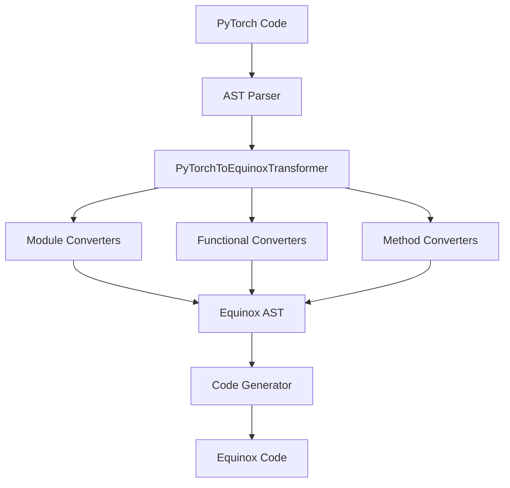

# EquiTorch: PyTorch to Equinox/JAX Transpiler

EquiTorch is an automatic code transpiler that converts PyTorch neural network models to functionally equivalent Equinox (JAX-based) implementations. It uses Abstract Syntax Tree (AST) transformation to seamlessly translate PyTorch's imperative style to JAX's functional programming paradigm.

## 🚀 Features

- **Automatic Code Translation**: Convert PyTorch models to Equinox with a single function call
- **Modular Architecture**: Clean separation of module, functional, and method converters
- **Type Safety**: Generates proper type annotations for Equinox modules
- **JAX Integration**: Handles JAX-specific patterns like `jax.vmap` and PRNG keys
- **Comprehensive Testing**: Extensive test suite with specific assertions for each transformation

### Currently Supported

✅ **Multi-Layer Perceptrons (MLPs)**  
✅ **Convolutional Neural Networks (CNNs)**  
🚧 **Recurrent Neural Networks (RNNs)** - In development  
🚧 **Long Short-Term Memory (LSTMs)** - In development  

### Planned Support

🔄 **Transformers**  
🔄 **Variational Autoencoders (VAEs)**  
🔄 **Generative Adversarial Networks (GANs)**  
🔄 **Neural ODEs**  

## 📦 Installation

### Requirements

- Python ≥ 3.12
- JAX and Equinox for running transpiled models
- PyTorch for source models

### Using uv (Recommended)

```bash
# Clone the repository
git clone <repository-url>
cd 25SS-EquiTorch

# Install dependencies
uv sync
```

### Using pip

```bash
# Clone the repository
git clone <repository-url>
cd 25SS-EquiTorch

# Install dependencies
pip install -e .

# Install development dependencies
pip install pytest pytest-cov
```

## 🎯 Quick Start

### Basic Usage

```python
from equitorch.transpiler import transpile

# Your PyTorch model code
pytorch_code = """
import torch.nn as nn
import torch.nn.functional as F

class MLP(nn.Module):
    def __init__(self, input_size, hidden_size, output_size):
        super(MLP, self).__init__()
        self.fc1 = nn.Linear(input_size, hidden_size)
        self.fc2 = nn.Linear(hidden_size, output_size)

    def forward(self, x):
        x = F.relu(self.fc1(x))
        x = self.fc2(x)
        return x
"""

# Transpile to Equinox
equinox_code = transpile(pytorch_code)
print(equinox_code)
```

### Output

```python
import jax
import jax.numpy as jnp
import equinox as eqx

class MLP(eqx.Module):
    fc1: eqx.nn.Linear
    fc2: eqx.nn.Linear

    def __init__(self, input_size, hidden_size, output_size, key=None, **kwargs):
        if key is None:
            key = jax.random.PRNGKey(0)
        self.fc1 = eqx.nn.Linear(input_size, hidden_size, use_bias=True, key=key_0)
        self.fc2 = eqx.nn.Linear(hidden_size, output_size, use_bias=True, key=key_1)

    def __call__(self, x):
        x = jax.nn.relu(jax.vmap(self.fc1)(x))
        x = jax.vmap(self.fc2)(x)
        return x
```

## 🧪 Running Tests

### Run All Tests

```bash
# Using pytest
pytest

# With coverage
pytest --cov=src/equitorch

# Verbose output
pytest -v

# Run tests via uv
uv run pytest
```

### Run Specific Test Categories

```bash
# Test MLP transpilation
pytest tests/equitorch/test_transpiler.py::test_mlp_transpilation -v

# Test CNN transpilation  
pytest tests/equitorch/test_transpiler.py::test_cnn_transpilation -v

# Test RNN transpilation (currently failing - in development)
pytest tests/equitorch/test_transpiler.py::test_rnn_transpilation -v

# Test LSTM transpilation (currently failing - in development)
pytest tests/equitorch/test_transpiler.py::test_lstm_transpilation -v
```

### Update Snapshots of Tests

```bash
# Update all snapshots and remove unused snapshots
pytest --snapshot-update

# Update snapshots from specific test
pytest tests/equitorch/test_transpiler.py::test_nn_transpilation --snapshot-update

# Update snapshots via uv
uv run pytest --snapshot-update
```

### Understanding Test Results

- **✅ MLP and CNN tests**: Should pass completely
- **❌ RNN and LSTM tests**: Currently failing but provide development roadmap
- **📁 Output files**: Transpiled code is saved to `tests/transpiled/` for inspection

## 🏗️ Project Structure

```
25SS-EquiTorch/
├── src/equitorch/                 # Main transpiler package
│   ├── transpiler.py             # Core AST transformation logic
│   └── converters/               # Modular converter system
│       ├── module_converters.py  # nn.Module → eqx.Module
│       ├── functional_converters.py # F.relu → jax.nn.relu  
│       └── method_converters.py  # x.view() → jnp.reshape()
├── tests/                        # Test suite
│   ├── equitorch/               # Transpiler tests
│   ├── resources/networks/      # Sample PyTorch models
│   └── transpiled/              # Generated Equinox code
├── pytorch_impl/                # Reference PyTorch implementations
├── equinox_impl/               # Reference Equinox implementations
└── docs/                       # Documentation
```

## 🔧 Adding New Components

EquiTorch uses a modular converter architecture that makes it easy to add support for new PyTorch constructs.

### Adding Module Converters

To support a new PyTorch module (e.g., `nn.BatchNorm2d`):

1. **Add to `src/equitorch/converters/module_converters.py`**:

```python
def convert_batchnorm2d(node: ast.Call, key_index: int) -> ast.Call:
    """Convert nn.BatchNorm2d to eqx.nn.BatchNorm."""
    return ast.Call(
        func=ast.Attribute(
            value=ast.Attribute(
                value=ast.Name(id="eqx", ctx=ast.Load()),
                attr="nn", ctx=ast.Load()
            ),
            attr="BatchNorm", ctx=ast.Load()
        ),
        args=node.args,
        keywords=node.keywords + [
            ast.keyword(arg="key", value=ast.Name(id=f"key_{key_index}", ctx=ast.Load()))
        ]
    )

# Add to MODULE_MAPPINGS
MODULE_MAPPINGS["BatchNorm2d"] = convert_batchnorm2d
```

2. **Update `__init__.py`** to export the new converter

3. **Add tests** in `test_transpiler.py`

### Adding Functional Converters

To support a new functional operation (e.g., `F.gelu`):

1. **Add to `src/equitorch/converters/functional_converters.py`**:

```python
FUNCTIONAL_MAPPINGS.update({
    "gelu": ("jax.nn", "gelu"),
})
```

2. **Add tests** to verify the transformation

### Adding Method Converters

To support a new tensor method (e.g., `.squeeze()`):

1. **Add to `src/equitorch/converters/method_converters.py`**:

```python
def transform_squeeze(node: ast.Call) -> ast.Call:
    """Transform x.squeeze() to jnp.squeeze(x)."""
    return ast.Call(
        func=ast.Attribute(
            value=ast.Name(id="jnp", ctx=ast.Load()),
            attr="squeeze", ctx=ast.Load()
        ),
        args=[node.func.value] + node.args,
        keywords=node.keywords
    )

METHOD_MAPPINGS["squeeze"] = transform_squeeze
```

### Development Workflow

1. **Identify the PyTorch construct** you want to support
2. **Find the appropriate converter module** (module/functional/method)
3. **Implement the converter function** following existing patterns
4. **Add comprehensive tests** with specific assertions
5. **Run tests** to verify the transformation works
6. **Update documentation** if needed

## 🗺️ Development Roadmap

### Current Status: RNN/LSTM Development

The project is actively working on RNN and LSTM support. See `RNN_LSTM_TEST_ROADMAP.md` for detailed development progress.

**High Priority:**
- `nn.RNN` → `eqx.nn.GRUCell` conversion
- `nn.LSTM` → `eqx.nn.LSTMCell` conversion  
- `jax.lax.scan` pattern generation for sequential processing
- `nn.Parameter` → `jnp.ndarray` conversion

**Medium Priority:**
- Advanced tensor operations (`torch.zeros` → `jnp.zeros`)
- Device reference removal
- JAX PRNG key management
- Complex attention mechanisms

### Architecture Transformations



### Conversion Examples

| PyTorch | Equinox/JAX |
|---------|-------------|
| `nn.Module` | `eqx.Module` |
| `nn.Linear(in, out)` | `eqx.nn.Linear(in, out, key=key)` |
| `F.relu(x)` | `jax.nn.relu(x)` |
| `x.view(-1, 784)` | `jnp.reshape(x, (-1, 784))` |
| `forward(self, x)` | `__call__(self, x)` |
| `self.layer(x)` | `jax.vmap(self.layer)(x)` |

## 🤝 Contributing

### Development Setup

```bash
# Clone and setup
git clone <repository-url>
cd 25SS-EquiTorch
uv sync

# Install pre-commit hooks (optional)
pre-commit install
```

### Code Style

The project uses:
- **Black** for code formatting (line length: 120)
- **Ruff** for linting with comprehensive rule set
- **pytest** for testing with coverage reporting

```bash
# Format code
black src/ tests/

# Lint code  
ruff check src/ tests/

# Run tests with coverage
pytest --cov=src/equitorch --cov-report=html
```

### Test-Driven Development

1. **Write failing tests** for new functionality
2. **Implement converters** to make tests pass
3. **Verify existing tests** still pass
4. **Update documentation** as needed

Example development cycle:
```bash
# 1. Add test for new feature
pytest tests/equitorch/test_transpiler.py::test_new_feature -v

# 2. Implement converter
# Edit src/equitorch/converters/...

# 3. Verify progress
pytest tests/equitorch/test_transpiler.py::test_new_feature -v

# 4. Run full test suite
pytest
```

## 📚 Additional Resources

- **TESTING.md**: Detailed testing instructions and troubleshooting
- **RNN_LSTM_TEST_ROADMAP.md**: Development roadmap for sequential models
- **docs/models.md**: Model architecture documentation
- **pytorch_equinox_mapping.md**: Mapping between PyTorch and Equinox constructs

## 📄 License

[Add your license information here]

## 🙏 Acknowledgments

This project is part of the 25SS Software Practical, exploring automatic transpilation between deep learning frameworks to leverage JAX's functional programming benefits while maintaining PyTorch's familiar API.
